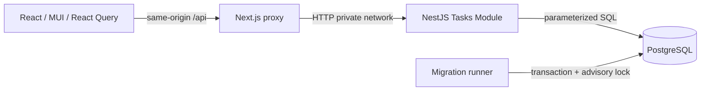

# Apree Workspace — System Design

## Границы

Одна общая доска локально либо публичная демоверсия с синтетическими данными. Пользовательские требования: [spec.md](../../specs/001-task-board/spec.md). Next.js отвечает за представление и same-origin proxy, NestJS — за валидацию и операции над задачами, PostgreSQL — за достоверность данных. В Next нет параллельной бизнес-логики или прямого доступа к БД.

## Данные и API

[Модель](../../specs/001-task-board/data-model.md), [контракт](../../specs/001-task-board/contracts/api.md). TasksModule: controller → service с параметризованными запросами → Database provider. Дополнительный универсальный repository не вводится: один ресурс и пять методов не оправдывают ещё один уровень.

Создание: клиентский UUID как ID задачи; повтор POST с тем же ID не создаёт дубликат и возвращает конфликт. PATCH и DELETE требуют положительный integer version. UPDATE/DELETE выполняются условно по id + version; ноль строк означает конфликт либо отсутствие. При успешном UPDATE version увеличивается в том же SQL. Два конкурирующих запроса с одной версией не могут оба записаться. Потеря ответа после успешной записи остаётся неоднозначной: интерфейс обновляет доску, не повторяет mutation автоматически. При повторе создания пользователь получает явный конфликт, дубликат не создаётся.

Порядок: created_at DESC, id DESC, неизменен при смене статуса. Список ограничен 1000 задач; ответ сообщает достижение лимита. Индекс порядка исключает полный sort больших таблиц. При превышении границы требуется cursor pagination, прежде чем расширять применение.

## Клиент и жизненный цикл

Один query ['tasks']; signal отменяет ненужный fetch, timeout 10 секунд. Данные проходят общую response schema. Начальная загрузка — skeleton, отказ — Retry; сбой фонового обновления оставляет кеш видимым с предупреждением. React Query refetch при возврате фокуса и reconnect, без WebSocket и интервалов.

Перенос немедленно меняет отображаемый статус; API сохраняет его в фоне. Очередь отдельно для каждой задачи объединяет быстрые повторные намерения и выполняет следующий PATCH с подтверждённой версией. Разные задачи сохраняются независимо. Пока есть переносы, фоновое чтение приостановлено, начатый GET отменяется; после завершения выполняется сверка с сервером. Подтверждённые записи обновляют кеш, ошибка снимает оптимистический статус и возвращает последний подтверждённый результат. На телефоне откат показывает соответствующую колонку, если пользователь после переноса не выбрал другую навигацию. Создание/редактирование/удаление ожидают сервер; изменение полей той же задачи во время переноса временно недоступно, повторный перенос доступен. Автоматического повтора неудавшейся записи нет. Выход при незавершённых переносах вызывает стандартное предупреждение браузера. Открытая форма хранит исходную версию и введённые значения независимо от фоновых загрузок, поэтому конфликт не затирает черновик. При закрытии dirty-формы запрашивается подтверждение.

## Валидация, безопасность и отказы

- Zod strict schemas на границе HTTP: не допускают unknown keys, null вместо строки, пробельный title, неверный UUID/status/priority/version. UI использует тот же контракт.
- SQL только с параметрами. DB CHECK повторяет базовые ограничения, timestamps/version контролирует сервер.
- Ограниченный JSON body; одинаковая форма ошибок, внутренние SQL/stack не возвращаются клиенту. DB timeout/connection error → 503, неожиданный отказ → 500 и серверный лог без тела задачи.
- Безопасные заголовки, no-store для API. CORS не включён: браузер работает через same-origin proxy. API по умолчанию слушает loopback, БД в compose наружу только на 127.0.0.1.
- Аутентификация не входит в согласованный объём. Публичная демоверсия намеренно общая: любой посетитель может менять синтетические задачи. Работа с закрытыми данными команды потребует отдельного этапа с авторизацией по доске и эксплуатационными мерами.
- БД недоступна: readiness возвращает отказ; приложение не переключается незаметно на localStorage.
- Shutdown завершает HTTP и pool. Pool ограничен 10 соединениями, таймауты подключения и запроса заданы.

## Миграции и эксплуатация

Отдельный runner: одна транзакция, advisory transaction lock, ledger с checksum. Повторный запуск безопасен; изменение применённого SQL вызывает отказ. Application startup не изменяет схему. Docker Compose: healthy PostgreSQL → миграции успешно завершены → API ready → web. Named volume сохраняет данные при обычном down/up. Команда down -v разрушает данные и не входит в обычный запуск.

Контейнеры приложения запускаются непривилегированным пользователем. Секреты передаются окружением, .env не отслеживается. Локальные значения .env.example не предназначены для внешнего сервера. Полезные проверки: /api/health для readiness, статус миграций в ledger, ошибки Nest и HTTP-состояния. Полный аудит действий, метрики, backups и SLA — отдельный эксплуатационный этап.

Публичная демоверсия по отдельному поручению пользователя размещается на Netlify (Next.js), Render Free (NestJS) и Neon Free (PostgreSQL/TLS). Вместо приватной сети между web/API используется HTTPS. Миграции выполняются перед стартом API. NEXT_PUBLIC_API_WAKEUP включает ограниченное ожидание пробуждения только для чтения; mutations не повторяются. Конфигурация, границы общей демодоски и бесплатные лимиты описаны в [deployment](../deployment.md).

## Производительность и развитие

Чтение O(n) до заданной границы; группировка/поиск на клиенте O(n), без SQL на каждую карточку. Одна mutation = один SQL при успехе. Индексированный стабильный порядок, ограниченный pool и отсутствие polling удерживают стоимость. Измерения локального запуска фиксируются в delivery, не считаются нагрузочным тестом.

При росте: cursor pagination + server filters → индексы по измеренным запросам → board_id и авторизация → события обновления. Микросервисы и кеш добавлять только по метрикам.
